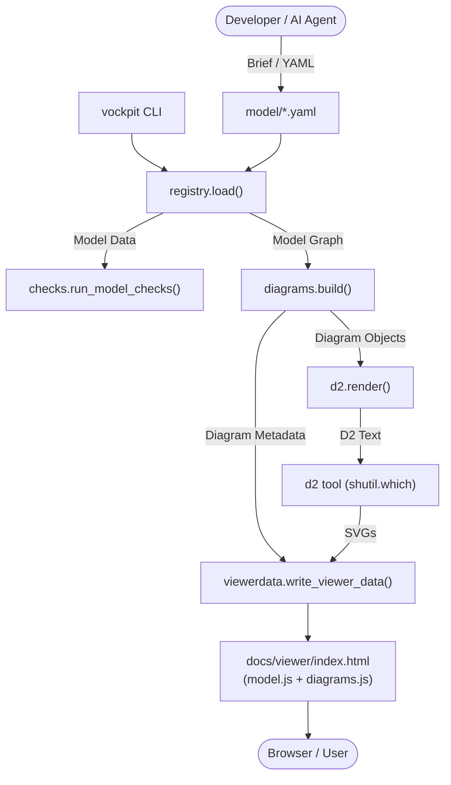

# Vockpit 0.1 Architecture

## 1. Overview
Vockpit ("the Vibe Coding Cockpit") is an agentic, diagram-first architecture tool. It ingests lightweight, declarative YAML files describing a software system, validates them across strict schema, identity, edge, freshness, and size rules, generates deterministic D2 diagrams and SVG assets, and outputs a self-contained static HTML drill-down viewer.

---

## 2. Abstraction Hierarchy

Vockpit strictly models systems across three levels:
1. **L0 (Context)**: The system as a single black box, surrounded by external actors (`person` or `external`).
2. **L1 (System)**: The subsystems directly comprising the system. Shows connections between subsystems and external actors.
3. **L2 (Subsystem Component)**: Internal decomposition of an L1 subsystem into component boxes. Shows internal data flows and external L1 neighbour subsystems.

---

## 3. Data Flow and Subsystems

### Registry Subsystem
- Discovers `model/system.yaml` and any `model/boxes/*.yaml`.
- Parses YAML mappings into immutable dataclasses (`System`, `Actor`, `Box`, `Edge`, `Model`).
- Assigns computed `level` (1 for system boxes, 2 for box file components) and computes `children` lists.

### Validation Engine (`checks`)
Follows a staged evaluation pipeline:
1. **Stage 1 (C01 - Schema)**: Verifies file existence, valid YAML syntax, required keys, strict typing, allowed keys whitelist, regex pattern `^[a-z][a-z0-9]*(-[a-z0-9]+)*$`, actor kinds, and parent file-name matching.
2. **Stage 2 (C02 - Identity & C03 - Edges)**: Evaluates global namespace uniqueness across actors and all boxes, verifies parent L1 existence, forbids system ID in edges, verifies valid endpoints, checks self-loops, and forbids direct actor-to-actor edges.
3. **Stage 3 (C10 - Freshness & C26 - Size)**: Ensures generated `.d2` and `model.js` files match in-memory generated outputs exactly. Warns if diagrams exceed 12 nodes.

### Diagram Generation (`diagrams`)
- Resolves nodes and edge representatives for L0, L1, and each L2 subsystem.
- Collapses multiple edges between identical entities into single edges with sorted, semicolon-separated labels.
- Groups and lists inner nodes first, followed by actors and neighbours sorted alphabetically by ID.

### D2 and Viewer Data Generation (`d2` & `viewerdata`)
- Converts `Diagram` objects into deterministic `.d2` text files using class styles and shapes (`person`, `system`, `inner`, `external`, `neighbour`).
- Compiles `model.js` (`window.VOCKPIT_MODEL`) and `diagrams.js` (`window.VOCKPIT_SVG`) for browser consumption.

### Drill-Down HTML Viewer
- Single-page application requiring no build step, framework, or network calls.
- Reacts to `hashchange` routes (`#/`, `#/<system>`, `#/<box>`).
- Features SVG pan/zoom, node highlight for leaf components, inspector sidebar with direct edge links, and keyboard `Escape` navigation.
